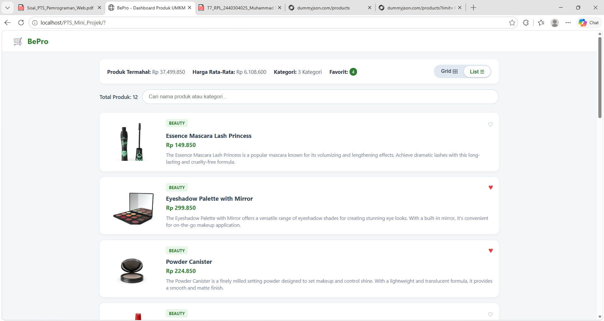
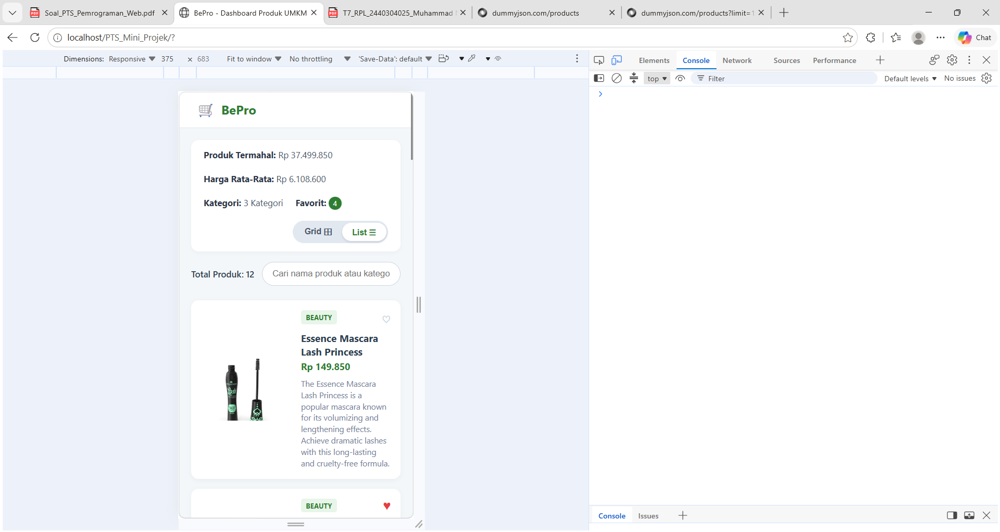

# 🛒 BePro (Beli Produk) - Dashboard Produk UMKM

Proyek Mini Front-End Interactive Data Dashboard ini disusun untuk memenuhi **Penilaian Tengah Semester (PTS) Pemrograman Web** pada Program Studi Teknik Komputer, Fakultas Teknik, Universitas Borneo Tarakan.

---

## 👨‍🎓 Identitas Mahasiswa

* **Nama Mahasiswa:** Muhammad Nur Alfian
* **NPM:** 2440304025
* **Semester / Angkatan:** Semester 5 / 2024
* **Program Studi:** Teknik Komputer, Universitas Borneo Tarakan

---

## 📝 Deskripsi Singkat Aplikasi

**BePro** merupakan singkatan dari **Beli Produk**, sebuah aplikasi web interactive dashboard front-end berbasis REST API. Aplikasi ini dirancang sebagai etalase produk UMKM interaktif yang memungkinkan pengguna untuk:
1. Menjelajahi katalog produk UMKM secara real-time yang diambil dari REST API DummyJSON.
2. Melihat analisis statistik data produk otomatis (harga termahal, rata-rata harga, dan jumlah kategori).
3. Menyimpan produk pilihan ke daftar **Favorit/Bookmark** yang tersimpan pada `localStorage`.
4. Mengubah mode tampilan katalog (**Grid View** vs **List View**) yang preferensinya tersimpan secara permanen pada `localStorage`.
5. Memberikan saran dan masukan bagi pengembangan produk UMKM melalui form interaktif berbasis validasi client-side.

---

## 🔢 Perhitungan Variasi Soal Berdasarkan NIM

Sesuai dengan ketentuan soal PTS, variasi proyek ditentukan menggunakan 3 digit terakhir NPM:
* **NPM:** `2440304025`
* **3 Digit Terakhir:** `X = 0`, `Y = 2`, `Z = 5`

### Penentuan Varian:
1. **Digit X = 0** $\rightarrow$ **Dataset:** `Products` (Tema: Dashboard Produk / UMKM).
2. **Digit Y = 2** $\rightarrow$ **Fitur Utama:** `Favorite / Bookmark` menggunakan `localStorage`.
3. **Digit Z = 5** $\rightarrow$ **Form & Validasi:** Validasi Nama minimal 5 karakter + Pesan/Saran tidak boleh kosong.
4. **Perhitungan Challenge Individual (C):**
   $$S = X + Y + Z = 0 + 2 + 5 = 7$$
   $$C = S \bmod 4 = 7 \bmod 4 = 3$$
   $\rightarrow$ **Challenge (C = 3):** `Toggle Grid/List`; pilihan pengguna disimpan pada `localStorage`.

---

## 🌐 Dataset & Endpoint REST API

* **Sumber Dataset:** DummyJSON REST API (`https://dummyjson.com/products`)
* **Endpoint REST API:** `https://dummyjson.com/products?limit=12`
* **Method:** `GET`
* **Proses Konversi:** Harga dari API (USD) dikonversi secara otomatis ke kurs simulasi Rupiah ($\text{USD} \times 15.000$) pada layer `js/api.js`.

---

## 🚀 Fitur Utama & Challenge Individual

1. **REST API Integration & Async Loading:** Mengambil data produk eksternal secara asinkronus menggunakan `fetch()` dan `async/await`. Dilengkapi penanganan *loading state* dan *error state* dengan tombol *Retry*.
2. **Analisis Data Otomatis:**
   * Produk Termahal (dihitung menggunakan `Array.prototype.reduce()`).
   * Rata-rata Harga Produk (dihitung menggunakan `Array.prototype.reduce()`).
   * Total Kategori Unik (dihitung menggunakan `Set` dan `Array.prototype.map()`).
3. **Pencarian Real-Time:** Filter pencarian interaktif berdasarkan nama produk atau nama kategori tanpa perlu *reload* halaman.
4. **Fitur Wajib Y=2 (Favorite/Bookmark):** Pengguna dapat menandai ikon hati ($\heartsuit$) pada kartu produk. ID produk favorit disimpan pada `localStorage` sehingga data tetap ada saat browser dibuka kembali.
5. **Challenge C=3 (Toggle Grid/List View):** Mengubah tata letak katalog antara Grid 3 kolom dan List horizontal. Pilihan mode disimpan di `localStorage`.
6. **Form & Validasi Z=5 (Saran & Masukan UMKM):**
   * Validasi Nama: Wajib diisi dan minimal 5 karakter.
   * Validasi Pesan: Wajib diisi dan tidak boleh kosong.
   * Menampilkan notifikasi sukses/error visual yang jelas di bawah input.

---

## 🛠️ Cara Menjalankan Project

1. **Prasyarat Server Lokal:** Karena proyek ini menggunakan **ES6 Modules** (`type="module"`), file harus dijalankan melalui *Local Web Server* (seperti Laragon, XAMPP, atau ekstensi Live Server di VS Code).
2. **Langkah-Langkah:**
   * Clone / ekstrak proyek ke folder server lokal (contoh: `C:\laragon\www\PTS_Mini_Projek`).
   * Buka Laragon / Apache Server, lalu akses melalui browser di alamat:
     `http://localhost/PTS_Mini_Projek/`
   * Atau, buka folder proyek di Visual Studio Code, klik kanan pada `index.html`, lalu pilih **Open with Live Server**.

---

## 📸 Screenshot Aplikasi

*(Silakan tempelkan gambar screenshot di folder `screenshots/` sebelum dikumpulkan)*

### Tampilan Desktop (Grid View)


### Tampilan Mobile (Responsive View)


---

## ❓ Jawaban 10 Pertanyaan Penjelasan Kode

### 1. Jelaskan alur sejak halaman dibuka sampai data REST API tampil. Sebutkan nama fungsi pada project Anda.
> **Jawaban:**
> Ketika halaman dibuka, event `DOMContentLoaded` memanggil fungsi `initApp()` di `js/app.js`. Fungsi ini terlebih dahulu memanggil `initViewMode()` dari `js/ui.js` untuk menerapkan mode tampilan (Grid/List) dari `localStorage`. Selanjutnya, `initApp()` memanggil fungsi asinkronus `fetchProducts()` pada `js/api.js` untuk mengambil data dari endpoint REST API DummyJSON. Selama proses pencerapan data, elemen `#loadingState` ditampilkan. Setelah data JSON diterima, `initApp()` mengoper array produk ke `calculateStatistics(allProducts)` di `js/stats.js` untuk menghitung analisis data, serta mengoper ke `renderProducts(allProducts)` di `js/ui.js` untuk membentuk elemen DOM kartu produk. Setelah render selesai, elemen `#loadingState` disembunyikan dan `#productContainer` ditampilkan.

### 2. Mengapa setelah `fetch()` selesai Anda masih perlu memeriksa `response.ok`? Jelaskan dengan kasus pada aplikasi Anda.
> **Jawaban:**
> Fungsi `fetch()` hanya akan mengalami *reject* (masuk ke blok `catch`) jika terjadi gangguan jaringan (misalnya komputer terputus dari internet). Namun, jika server DummyJSON merespon dengan status error HTTP seperti `404 Not Found` atau `500 Internal Server Error`, `fetch()` tetap menganggap Promise berhasil (*resolved*). Oleh karena itu, pemeriksaan `if (!response.ok)` wajib dilakukan pada `js/api.js`. Jika `response.ok` bernilai `false`, program secara sengaja mengulang lemparan error (`throw new Error(...)`) agar alur eksekusi langsung berpindah ke blok `catch` dan menampilkan pesan error visual ke pengguna melalui fungsi `initApp()`.

### 3. Pilih satu data JSON dari API dan jelaskan bagaimana data tersebut diubah menjadi elemen DOM yang terlihat.
> **Jawaban:**
> Pada modul `js/api.js`, objek JSON bawaan API misalnya:
> `{ id: 1, title: "Essence Mascara Lash Princess", price: 9.99, category: "beauty", thumbnail: "..." }`
> Dikonversi menjadi objek lokal dengan harga Rupiah:
> `{ id: 1, title: "Essence Mascara Lash Princess", price: 149850, category: "beauty", image: "..." }`.
> Pada `js/ui.js` dalam fungsi `renderProducts()`, objek ini diurai dalam perulangan `forEach`. Kode membuat elemen baru `document.createElement('div')` dengan class `.product-card`, lalu mengisi propertinya menggunakan *Template Literals*:
> `card.innerHTML = '...<h3 class="product-title">${item.title}</h3>...'`.
> Elemen kartu tersebut kemudian dimasukkan ke dalam struktur halaman menggunakan `productContainer.appendChild(card)` sehingga dirender oleh browser.

### 4. Apa yang terjadi jika internet terputus, endpoint salah, atau server mengembalikan HTTP 404/500? Jelaskan penanganannya.
> **Jawaban:**
> Jika internet terputus, `fetch()` akan langsung melempar exception (*Network Error*). Jika endpoint salah atau server mengembalikan HTTP 404/500, pemeriksaan `!response.ok` di `js/api.js` akan melempar `Error`. Kedua kondisi ini akan ditangkap oleh blok `try...catch` pada fungsi `initApp()` di `js/app.js`. Blok `catch` kemudian menyembunyikan `#loadingState` dan menampilkan elemen `#errorState` yang berisi pesan kesalahan serta tombol "Coba Lagi 🔄" (`#btnRetry`). Pengguna dapat menekan tombol tersebut untuk memicu eksekusi ulang fungsi `initApp()`.

### 5. Jelaskan bagaimana fitur berdasarkan digit Y bekerja. Cantumkan nama fungsi/event yang digunakan.
> **Jawaban:**
> Fitur berdasarkan digit Y=2 adalah **Favorite/Bookmark**. Saat pengguna mengklik tombol hati (`.btn-fav`), fungsi penangan event `toggleFavorite(id, currentProducts)` di `js/ui.js` dieksekusi. Fungsi ini memeriksa apakah ID produk sudah ada di array `favorites`. Jika sudah ada, ID dihapus (`filter`); jika belum ada, ID ditambahkan (`push`). Array `favorites` kemudian disimpan ke `localStorage` dalam bentuk string JSON menggunakan `localStorage.setItem('bepro_favorites', JSON.stringify(favorites))`. Selanjutnya fungsi `updateFavBadge()` memperbarui angka badge di header (`#favCountBadge`), dan `renderProducts()` dipanggil ulang untuk memperbarui status visual ikon hati.

### 6. Jelaskan bagaimana validasi berdasarkan digit Z bekerja dan mengapa input tidak valid tidak boleh langsung diproses.
> **Jawaban:**
> Digit Z=5 mewajibkan **Validasi Nama minimal 5 karakter**. Saat form dikirim, event handler `handleFormSubmit(e)` memanggil `e.preventDefault()` untuk menghentikan submit bawaan browser. Fungsi mengambil nilai input nama (`namaInput.value.trim()`) dan memeriksa panjang string (`namaValue.length < 5`). Jika kurang dari 5 karakter, variabel `isValid` diubah menjadi `false`, dan teks peringatan ditampilkan pada elemen `#namaError`. Input yang tidak valid dilarang diproses langsung untuk mencegah masuknya data sampah (*garbage data*), menjaga integritas database/sistem, serta memberikan umpan balik langsung yang jelas kepada pengguna (*client-side feedback*).

### 7. Jika project Anda menggunakan localStorage, jelaskan data apa yang disimpan, kapan data dibaca/diubah, dan alasan penggunaannya.
> **Jawaban:**
> Aplikasi ini menggunakan `localStorage` untuk dua fitur:
> 1. `bepro_favorites`: Menyimpan array ID produk favorit pengguna (misal `[1, 3, 5]`).
> 2. `bepro_view_mode`: Menyimpan string pilihan tata letak (`"grid"` atau `"list"`).
> Data dibaca saat pertama kali aplikasi dimuat (`DOMContentLoaded`) untuk menginisialisasi tampilan awal sesuai preferensi pengguna sebelumnya. Data diubah setiap kali pengguna mengklik tombol favorit atau tombol toggle Grid/List. `localStorage` digunakan agar preferensi dan penandaan pengguna tidak hilang ketika halaman di-*refresh* atau browser ditutup.

### 8. Pilih satu fungsi JavaScript penting, lampirkan potongan maksimal 15 baris, lalu jelaskan input - proses - output.
> **Jawaban:**
> **Potongan Kode Fungsi `calculateStatistics` (`js/stats.js`):**
> ```javascript
> export function calculateStatistics(data) {
>   if (!data || data.length === 0) return;
> 
>   const termahal = data.reduce((prev, current) => 
>     (prev.price > current.price) ? prev : current
>   );
>   const totalHarga = data.reduce((acc, curr) => acc + curr.price, 0);
>   const avgHarga = Math.round(totalHarga / data.length);
>   const categories = new Set(data.map(item => item.category));
> 
>   document.getElementById('statTermahal').textContent = `Rp ${termahal.price.toLocaleString('id-ID')}`;
>   document.getElementById('statRataRata').textContent = `Rp ${avgHarga.toLocaleString('id-ID')}`;
>   document.getElementById('statKategori').textContent = `${categories.size} Kategori`;
> }
> ```
> * **Input:** Array `data` berisi objek-objek produk hasil fetch REST API.
> * **Proses:** Memproses array menggunakan `reduce()` untuk mencari objek dengan harga tertinggi dan menghitung total harga (kemudian dibagi panjang array untuk rata-rata), serta memetakan kategori ke dalam `Set` untuk menghitung nilai unik.
> * **Output:** Memperbarui teks pada elemen DOM `#statTermahal`, `#statRataRata`, dan `#statKategori` secara otomatis.

### 9. Sebutkan bug/error paling sulit selama PTS, penyebabnya, cara menemukannya, dan cara memperbaikinya.
> **Jawaban:**
> Bug paling krusial terjadi ketika mengubah data produk menjadi ES6 Modules (`type="module"`), di mana fungsi penangan event seperti `toggleFavorite()` yang dipanggil langsung via atribut HTML `onclick="toggleFavorite(...)"` menghasilkan error `Uncaught ReferenceError: toggleFavorite is not defined`.
> * **Penyebab:** Modul ES6 memiliki cakupan terisolasi (*scoped*) dan tidak mendaftarkan fungsinya ke objek `window` global.
> * **Cara Menemukan:** Melalui penelusuran Developer Tools - Console tab saat mengklik tombol favorit.
> * **Cara Memperbaiki:** Menghapus atribut `onclick` bawaan pada elemen HTML string dan menggantinya dengan penambahan event listener secara terprogram di JS menggunakan `favBtn.addEventListener('click', ...)` saat elemen kartu dirender pada `js/ui.js`.

### 10. Jika diberi satu minggu lagi, sebutkan dua perbaikan teknis yang akan Anda lakukan dan alasannya.
> **Jawaban:**
> 1. **Penerapan Debounce pada Input Pencarian Real-Time:** Menambahkan fungsi *debounce* (penundaan eksekusi 300ms) pada event input pencarian agar proses filter array tidak dieksekusi secara berlebihan di setiap ketukan tombol keyboard, sehingga meningkatkan efisiensi performa rendering.
> 2. **Integrasi Modal Detail Produk dengan History API / LocalStorage:** Menambahkan fitur popup modal detail item ketika kartu produk diklik, serta menyimpan riwayat 3 item terakhir yang dilihat pengguna pada `localStorage` untuk meningkatkan pengalaman pengguna (*User Experience*).

---

## 🤖 AI Usage Log

Pencatatan rinci mengenai penggunaan kecerdasan buatan (AI) selama proses analisis, perancangan, dan diagnosa error pada pengembangan proyek ini dikelola dalam file terpisah sesuai dengan kebijakan integritas akademik PTS Pemrograman Web.

Silakan buka file dokumentasi log di repository GitHub ini:
👉 **[Lihat AI_USAGE_LOG.md](./AI_USAGE_LOG.md)**

## 🔗 Tautan Repository GitHub

Kamu bisa langsung mengakses dan melihat kode sumber lengkap dari proyek ini melalui tautan berikut:
👉 Repository GitHub BePro - [alfioid/PTS_Mini_Projek](https://github.com/alfioid/PTS_Mini_Projek)